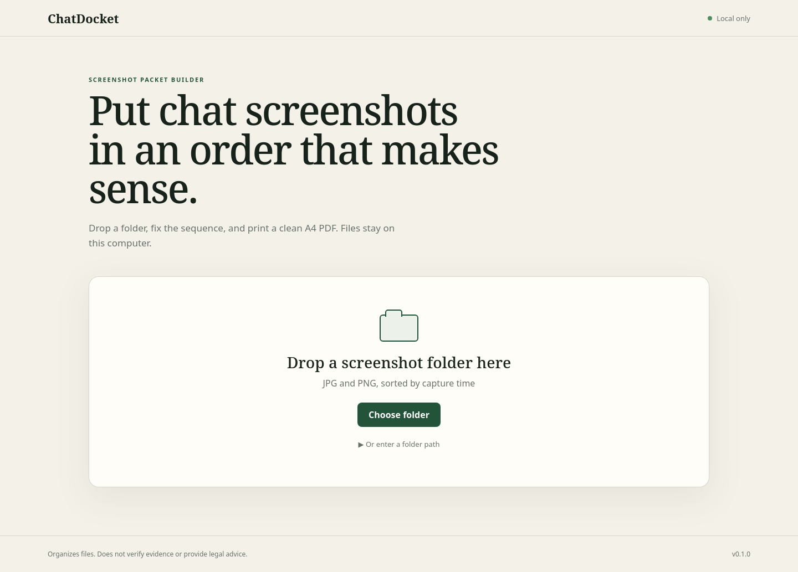

# ChatDocket

Chat screenshots are easy to collect and surprisingly annoying to print in a useful order. ChatDocket gives you a small sorting desk in your browser, then makes an A4 PDF with page numbers, source filenames, and capture times. It runs on your computer and does not upload anything.



## Install

ChatDocket needs Python 3.10 or newer. From the project folder:

```sh
python3 -m venv .venv
. .venv/bin/activate
pip install -r requirements.txt
pip install -e . --no-build-isolation
```

On Windows, activate the environment with `.venv\Scripts\activate` instead.

## Use it

Start the local server:

```sh
chatdocket
```

Open `http://127.0.0.1:8765`, then drop a folder of JPG or PNG screenshots onto the page. ChatDocket sorts by EXIF capture time when available, falling back to the file modification time. Drag the cards if the order needs correcting, choose 1, 2, or 4 screenshots per page, and enter where the PDF should be saved.

For a quick try, use the fictional files in `demo/sample-chat/`. `demo/chatdocket-demo.pdf` is the output produced from those four images with the two-per-page setting.

Run the tests with:

```sh
pip install -r requirements-dev.txt
pytest -q
```

## What it does not do

ChatDocket organizes images. It does not run OCR, inspect message text, prove who made a screenshot, maintain a chain of custody, or make a document legally admissible. Ask a qualified professional what your situation requires.

The server binds to `127.0.0.1` by default. Files selected in the browser are copied to a temporary local folder for the session and deleted when the server stops.

## Known issues

- Browser folder imports are sent to the local server as one JSON request, so very large folders can hit the 100 MB request limit. TODO: stream large imports instead of buffering them.
- Built-in PDF fonts do not cover every writing system. Filenames containing unsupported glyphs may not render correctly in the PDF footer. TODO: bundle a compact Unicode font.
- ChatDocket reads only the chosen folder, not nested folders, and has no annotation or redaction tools.

## Dependency licenses

These were checked against the metadata of the pinned environment used for 0.1.0.

| Package | Version | Why it is here | License |
| --- | --- | --- | --- |
| Pillow | 10.2.0 | Image metadata, orientation, and sizing | HPND |
| ReportLab | 5.0.1 | PDF creation | BSD |
| charset-normalizer | 3.5.2 | ReportLab runtime dependency | MIT |
| pytest | 9.1.1 | Tests only | MIT |
| iniconfig | 2.3.1 | pytest dependency | MIT |
| packaging | 26.3 | pytest dependency | Apache-2.0 or BSD-2-Clause |
| pluggy | 1.6.0 | pytest dependency | MIT |
| Pygments | 2.21.0 | pytest dependency | BSD-2-Clause |
| setuptools | 84.0.0 | Local package build | MIT |

Pillow is the one deliberate exception to an MIT/BSD/Apache-only dependency rule: the project requires Pillow, and Pillow identifies its license as HPND. HPND is an OSI-approved permissive license, but it is not being relabelled here as MIT or BSD.

## License

ChatDocket is released under the [MIT License](LICENSE).
